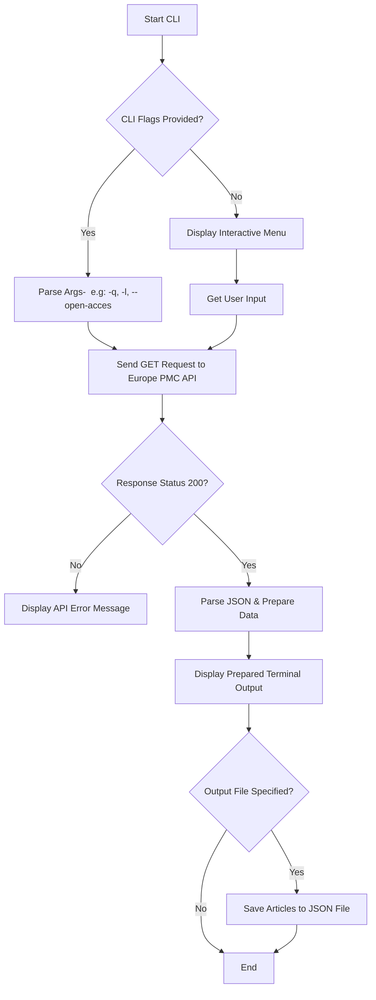

# BioPaper Fetcher CLI

A lightweight CLI tool to search and retrieve biomedical articles using [Europe PMC REST API](https://europepmc.org/RestfulWebService).



## Usage

```bash
# Flag mode (Direct search)
python main.py -q "CRISPR" -l 3 --open-access

# Interactive mode (Interactive input)
python main.py
```

> **[!] Note:** This is an initial prototype (v0.1.0). Additional features and enhancements are actively planned.